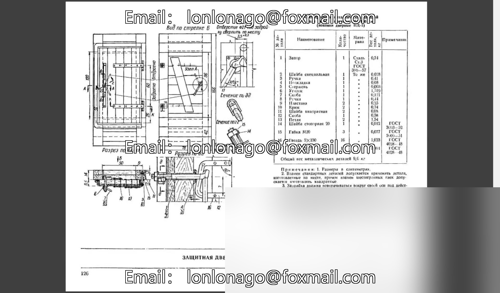
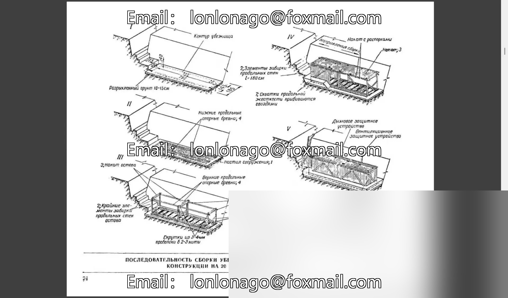
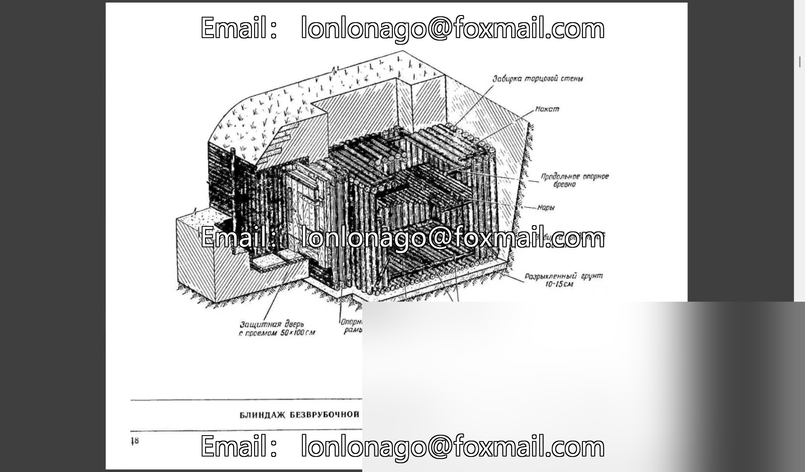
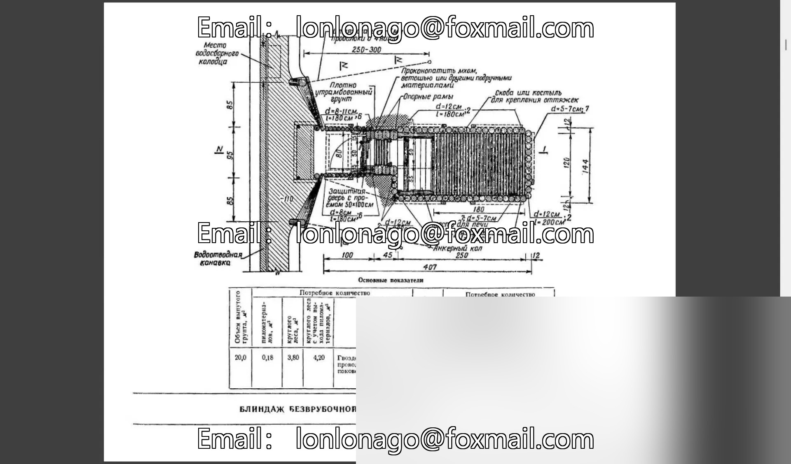
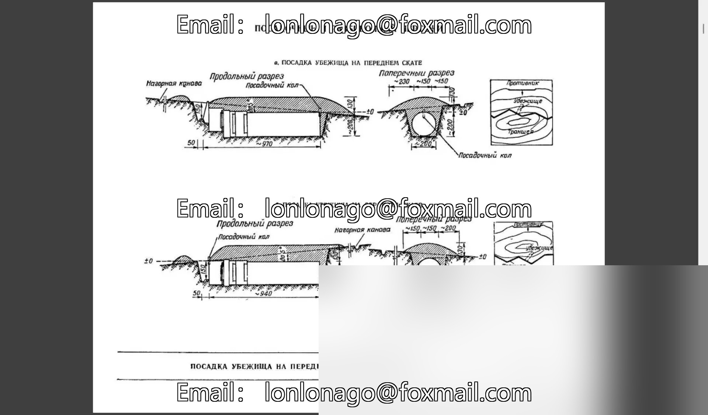

# Soviet Army field fortification design manual

## Body

Soviet Army Field Fortification Design Manual
130 pages.
1959 edition, Russian original PDF, authoritative content, including detailed design drawings such as typical fortification structures, protective doors, cover, and fortification layouts, suitable for military enthusiasts, historical research, and collection reference.

may be copied, and are not refundable upon sale.

This is the Soviet Army's field construction design manual, consisting of 130 pages and covering detailed design diagrams for typical constructions, protective doors, shelters and layout.

<!-- AI_ENRICHED -->

## Images

## Payment

Here is a pay link on Stripe ( https://buy.stripe.com/3cs8yP7sY87d0vu9AB ). Please contact me lonlonago@foxmail.com after funding $89, and I will send you a complete data files , thank you!

